# Tabletop GM

**A tailored cybersecurity tabletop exercise, built in an afternoon, scored in one command.**

Tabletop GM turns three things most organizations already have into a complete, evidence-backed incident response exercise: their exposure data (Tenable, a scan export, or a sample estate), their regulators (an industry pack of notification deadlines with sources), and their own written incident response plan. A deterministic Python engine computes everything that has to be right. Claude does the judgment work inside Claude Code. The result is a deck for the room, a script for the facilitator, a tracker for the host, and, afterwards, an after-action report and an executive summary that leadership can act on.

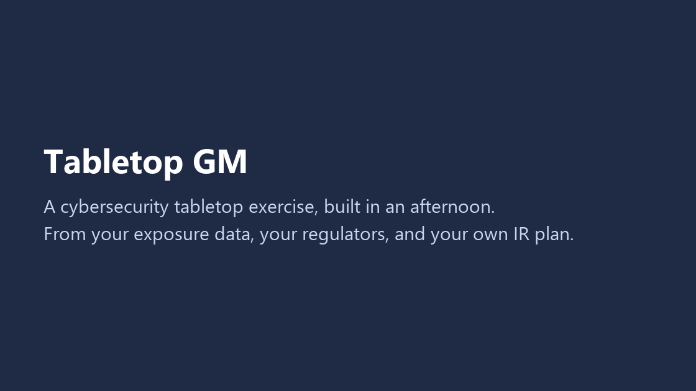

*Every frame above is a real page from the committed sample run in [`samples/outputs/`](samples/outputs/). Nothing is mocked.*

| | |
|---|---|
| **Try it in 10 seconds** | Download the ZIP, double-click the launcher, choose 1. No account, no keys, no network after setup. See [Quick start](#quick-start). |
| **Sample outputs** | [Deck](samples/outputs/deck.pptx) · [Facilitator guide](samples/outputs/facilitator_guide.docx) · [Decision tracker](samples/outputs/decision_tracker_completed.xlsx) · [After-action report](samples/outputs/after_action_report.docx) · [Executive summary slides](samples/outputs/executive_summary.pptx) · [Executive memo](samples/outputs/executive_summary.docx) |
| **Engine files behind them** | [seed.json](samples/outputs/seed.json) (attack path) · [clocks.json](samples/outputs/clocks.json) (deadlines) · [exercise_pack.json](samples/outputs/exercise_pack.json) (approved outline) · [score.json](samples/outputs/score.json) |
| **Status** | 132 automated tests pass. Pure Python, six dependencies, MIT. Read-only against every external system. |

## Contents

- [The problem](#the-problem)
- [What it does](#what-it-does)
- [See it](#see-it)
- [How the workflow goes](#how-the-workflow-goes)
- [Architecture](#architecture)
- [Why it is different](#why-it-is-different)
- [Prerequisites](#prerequisites)
- [How to run](#how-to-run)
- [Outputs](#outputs)
- [Industry packs](#industry-packs)
- [Known limitations](#known-limitations)
- [Roadmap](#roadmap)

## The problem

Regulators, insurers, and auditors expect organizations to exercise their incident response plan. Most tabletop exercises are still a generic ransomware story bought from a consultancy or copied from a template. The scenario does not touch the systems the organization actually runs, the deadlines on the slides are whatever someone remembered, and the "plan" the room is tested against is rarely the one in the binder. The after-action report arrives weeks later and says "improve communication."

Tabletop GM fixes the three things that make an exercise worth running:

1. **The attack path is yours.** The entry point is an exploitable, internet-facing finding from your exposure data (CISA KEV first, then highest Tenable VPR). The pivot is your identity tier. The crown jewel is the asset that holds your regulated data. Every inject cites the finding it came from.
2. **The deadlines are real and sourced.** An industry pack supplies every notification clock that applies to you, each with its source URL, the date it was checked, and whether a human has verified it.
3. **The plan under test is your plan.** Your uploaded IR plan and playbooks are extracted with section anchors. Every inject names the procedure it tests and quotes it verbatim. A validator rejects any quote that does not exist in the source.

## What it does

Tabletop GM ships as a Claude Code skill (`/tabletop`) on top of a deterministic command-line engine (`ttx`).

1. **Intake.** A few screens of clickable choices: industry, length (30, 60, or 90 minutes), severity 1 to 4, the data you hold, regulated status. Typing is limited to the organization's name and its US states.
2. **Policy ingest (optional).** `ttx ingest-plan` extracts your IR plan and playbooks with section anchors. Claude maps each procedure to an `org_plan.json` item carrying a verbatim quote, and the validator confirms every quote exists in the source.
3. **Attack path.** `ttx seed` picks the entry, pivot, and crown jewel from Tenable, an uploaded export, or the synthetic sample estate, and records the rule that fired for each. With no data, the scenario is generic and every assumption is labeled.
4. **Clocks.** `ttx clocks` returns the notification deadlines that apply, each with a source, a checked date, and a tier.
5. **Outline.** `ttx outline` writes a complete, valid skeleton. Each inject cites a finding or a labeled assumption and names the plan procedure it tests. Claude refines the narrative, then reviews it adversarially.
6. **Approval gate.** A named human approves the outline with `ttx approve`. Nothing builds before that. Any later edit breaks the approval hash.
7. **Build.** `ttx build` writes the deck, facilitator guide, participant handout, decision tracker, attendance sheet, and sign-off sheet from the approved pack only.
8. **Run it.** Three ways: the deck and the facilitator guide in a room, the exercise facilitated live by Claude in the chat on the projector, or the built-in sample for a practice run.
9. **Score and report.** `/tabletop-report` (or `ttx report`) scores the filled tracker against your plan's own commitments and the pack defaults, then writes the after-action report and the executive summary in one step. For a pitch, `ttx report --demo` scores synthetic responses and marks every page as demo data.

## See it

The fastest path is the launcher (option 1). From a terminal, after [installing](#command-line):

```bash
ttx demo --no-open
```

```text
Building the sample exercise into out\demo (synthetic data, no network, no model)...
  deck                         out\demo\deck.pptx
  facilitator_guide            out\demo\facilitator_guide.docx
  participant_handout          out\demo\participant_handout.docx
  decision_tracker             out\demo\decision_tracker.xlsx
  attendance                   out\demo\attendance_signin.xlsx
  signoff                      out\demo\signoff_sheet.docx
  decision_tracker_completed   out\demo\decision_tracker_completed.xlsx
  after_action_report          out\demo\after_action_report.docx
  executive_summary_slides     out\demo\executive_summary.pptx
  executive_summary_memo       out\demo\executive_summary.docx

Sample result: VRHS scored 82.8% across 7 decisions; strongest on right owner, weakest on timely;
HIPAA Breach Notification Rule, notice to prominent media outlets missed by 30 days.
2 plan, 11 people, and 3 technical gaps.
```

That run takes under two seconds and makes no network call. Valley Regional Health System is a fictional 1,200-employee health system; its estate, IR plan, and completed tracker are synthetic.

### What the room sees

One slide per inject. The systems named (vpngw01, dc1, sql2016) and the CVEs come from the seed, not from the model. Host lines are in the speaker notes. No spoilers on screen.

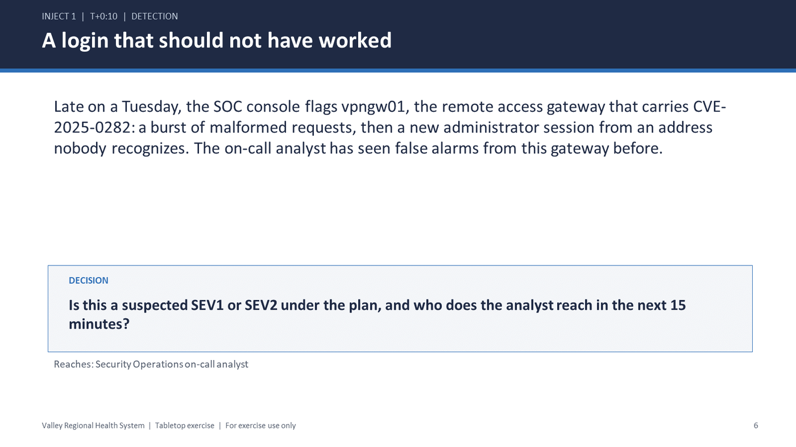

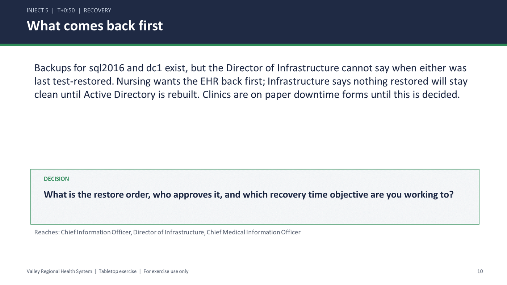

### What the facilitator holds

Per inject: host lines to read aloud, the decision and who owns it, a "what the plan says" box with the verbatim quote and its section, what good looks like, where teams usually fail, expected actions with their citation, hints, and probing questions.

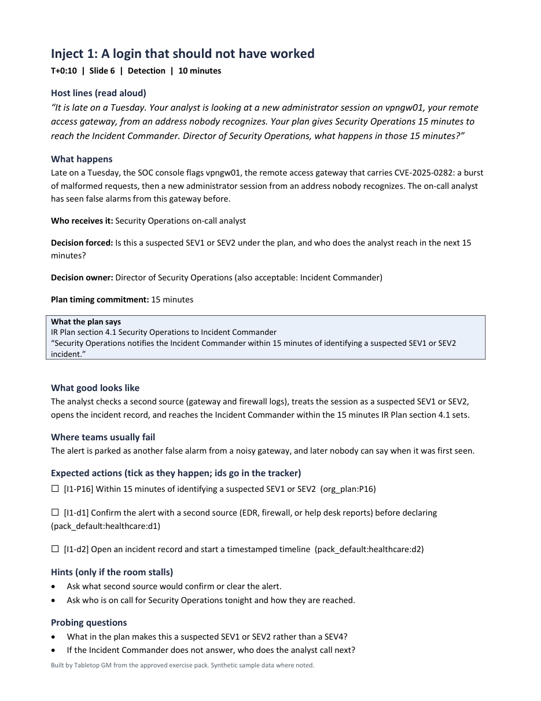

### What the host fills in

One color-coded block per inject. Dropdowns and Yes/No only, with the plan's own commitment shown beside each answer. `ttx report` reads this file.

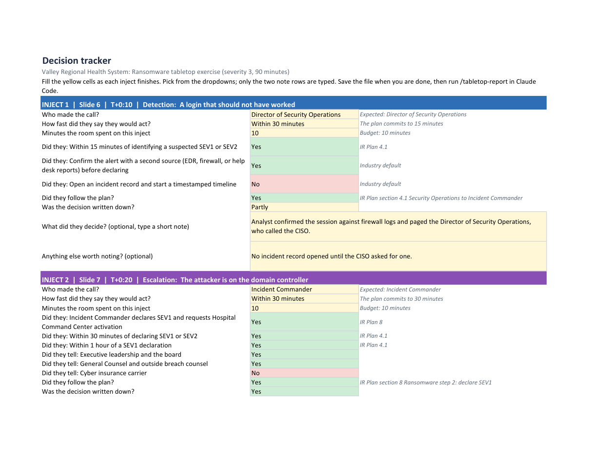

### What leadership gets

The after-action report opens with the result, lessons learned, and one row per decision. Scores by dimension, the plan coverage map, every gap with its citation, and an evidence page with hashes sit in the appendix.

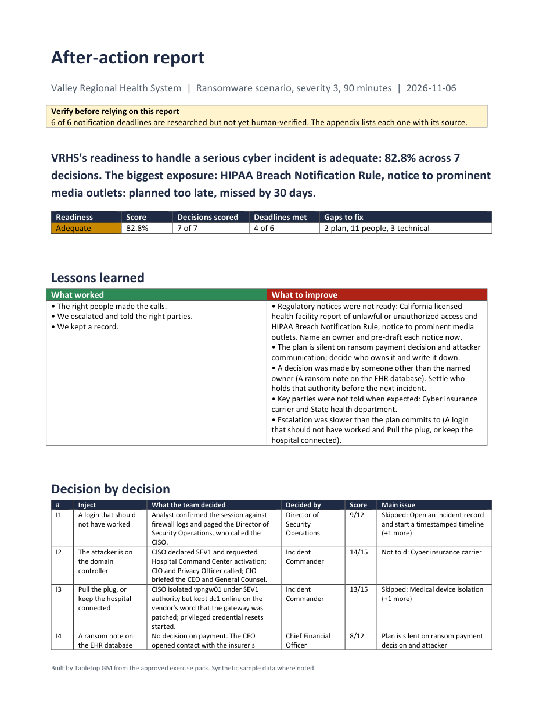

The executive summary is seven slides and a one-page memo: a plain-language bottom line, a readiness rating, regulatory exposure, lessons learned, the fixes with owners and due dates, and the decisions leadership needs to make. No finding IDs, no rubric.

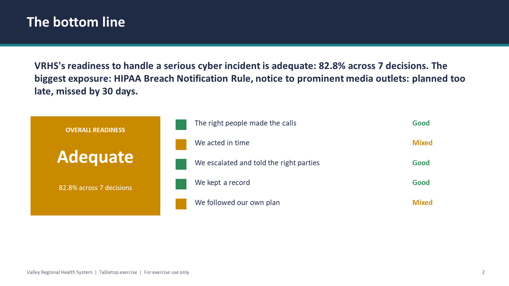

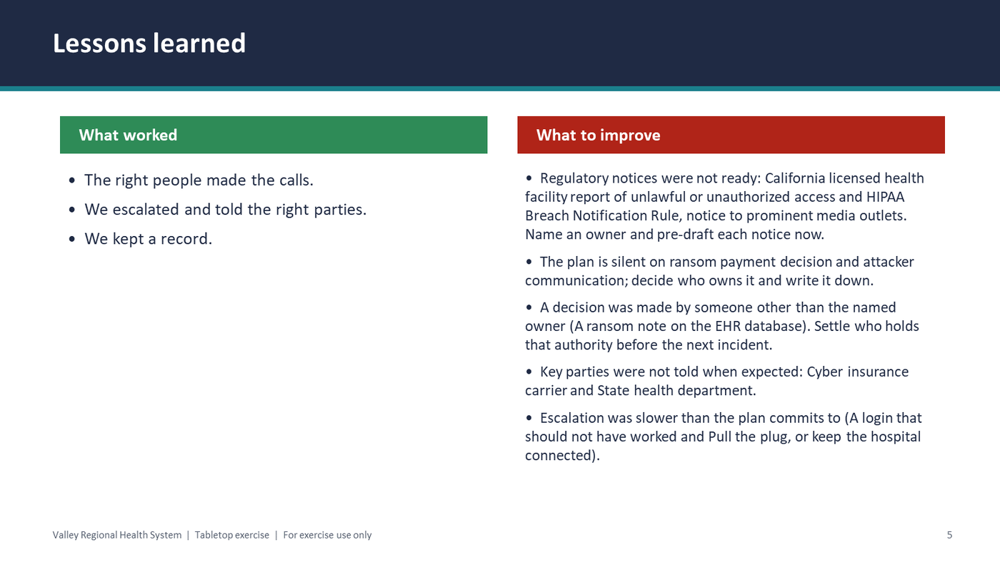

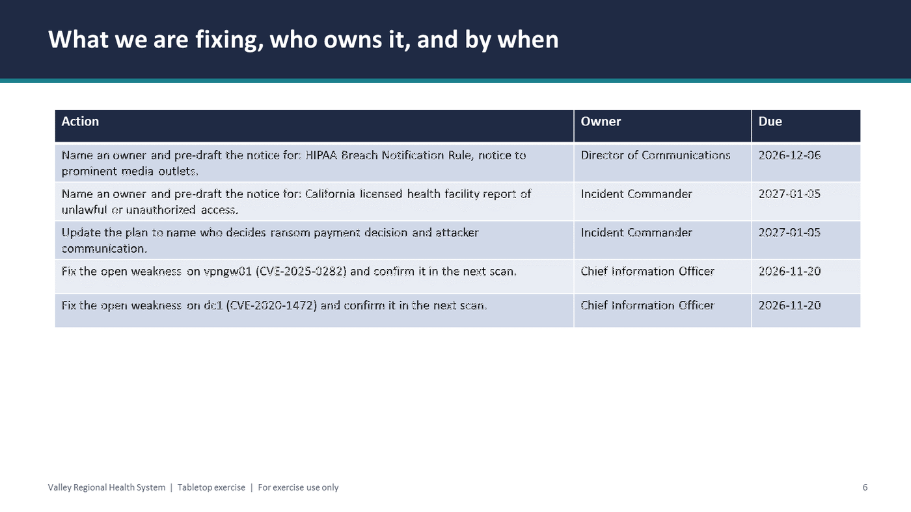

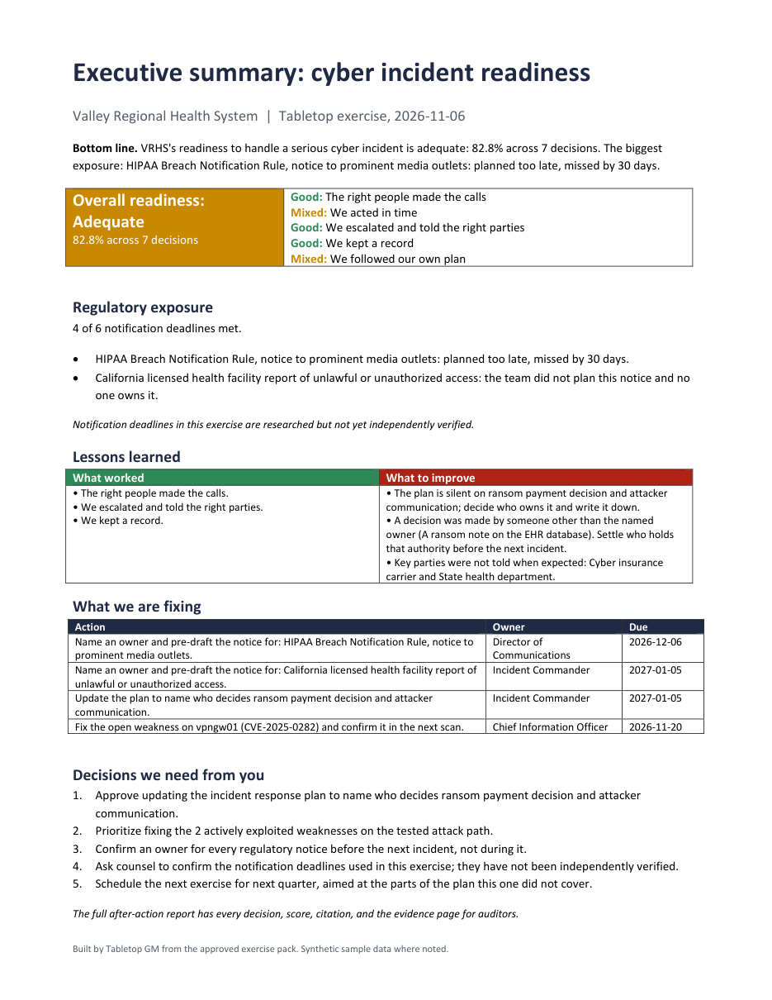

## How the workflow goes

There are two people in the story: the **host** (the person who prepares and runs the exercise, usually a security lead) and the **room** (the executives and responders being exercised). The room never sees a terminal.

```mermaid
flowchart LR
    subgraph Prep["Before the day (host, in Claude Code)"]
        A["/tabletop interview<br/>a few clicks"] --> B["Drop IR plan and scan export<br/>in uploads/"]
        B --> C["Engine: seed, clocks, outline"]
        C --> D["Claude: narrative,<br/>adversarial review"]
        D --> E{"Host approves<br/>the outline"}
        E -- "change, easier, harder" --> D
        E -- approve --> F["ttx build<br/>deck, guide, handout,<br/>tracker, sign-in, sign-off"]
    end
    subgraph Day["On the day (the room)"]
        F --> G["Deck on the projector,<br/>guide in the host's hands"]
        F --> H["Or: Claude facilitates live<br/>in the chat on the projector"]
        G --> I["Host records each decision<br/>in the tracker"]
        H --> J["Host types what the room decides;<br/>ttx log timestamps it"]
    end
    subgraph After["Afterwards (host, one command)"]
        I --> K["/tabletop-report"]
        J --> K
        K --> L["After-action report<br/>Executive summary slides and memo<br/>Sign-off sheet"]
    end
```

**The host's afternoon, in order:**

1. Open the folder in Claude Code and type `/tabletop`. Answer six short screens, mostly by clicking.
2. Optionally drop the IR plan, playbooks, or a scan export into `uploads/`. Claude offers to use them.
3. Review the outline as a table: each inject, the decision it forces, who owns it, and which plan procedure it tests. Click **Approve**, **Change an inject**, **Make it easier**, or **Make it harder**.
4. The documents land in `out/build/`. Print the guide, load the deck, open the tracker.

**The room's 90 minutes:** the host reads the inject, the room decides, the host picks from dropdowns. Clocks start at the inject the pack defines, and the tracker's Clocks sheet records who owns each notification and when they will send it.

**The host's ten minutes afterwards:** save the tracker, type `/tabletop-report`. The after-action report, the executive slides, and the memo are written with every gap labeled plan, people, or technical, and every one cited.

**Live in chat instead of a deck:** in a fresh chat, choose **Run an exercise live**. Claude shows one inject at a time, speaks short labeled stakeholder lines when the room stalls, asks at most two follow-ups, and logs each decision with a wall-clock timestamp through `ttx log`. `END` closes the session, shows the log for corrections, and produces the same scored report set. Claude cannot introduce a system, finding, deadline, or number that is not in the approved pack.

## Architecture

**Deterministic engine first, model on top.** The engine computes every fact that has to be right. The model is only allowed to write prose on top of facts the engine returned, and validators check that it did.

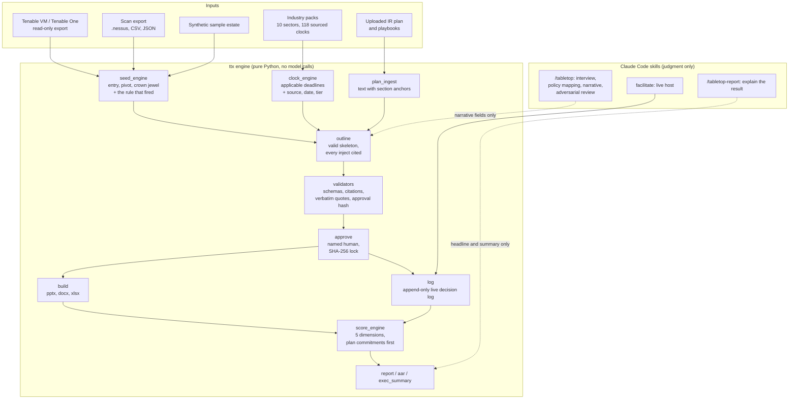

The approved `exercise_pack.json` is the single source of truth. Every output and every later step reads only that file, and its hash is recorded on the sign-off sheet and the AAR evidence page.

| Guardrail | How it is enforced |
|---|---|
| No invented systems, findings, or deadlines | Claude writes narrative fields only, through `ttx narrate`. The seed, clocks, and citations come from the engine. The skills forbid naming anything a `ttx` command did not return. |
| Every inject cites its source | `ttx validate exercise-pack` fails any inject without a finding ID or a labeled assumption. |
| Every plan claim is a real quote | `ttx validate org-plan` rejects any quote not found verbatim in the extracted plan text. |
| Every clock is sourced and tiered | Pack schema requires `source_url`, `checked_date`, and `tier`. Researched-tier clocks carry a "verify before exercise" banner on every output. |
| Human in the loop | `ttx approve --by <name>` locks the pack. Builds refuse an unapproved or modified pack. Claude never approves on anyone's behalf. |
| Read-only everywhere | Tenable export endpoints only. One optional unauthenticated GET for the CISA KEV feed. No telemetry. [SECURITY.md](SECURITY.md) lists every outbound call. |
| No secrets or real data in the repo | `.env`, `uploads/`, and `out/` are gitignored. Samples are synthetic. |
| Reproducible without a model | Every document rebuilds from `exercise_pack.json` with no API key. 132 tests cover the engine, validators, builders, scoring, launcher, and live log. |

The code is about 7,400 lines of Python across `ttx/` and `ttx/build/`, plus the skills under `skills/` and `.claude/skills/`, the schemas under `schemas/`, and the industry packs under `skills/industry_packs/`. [docs/BUILD_SPEC.md](docs/BUILD_SPEC.md) is the full specification and [docs/DECISIONS.md](docs/DECISIONS.md) records the build decisions.

## Why it is different

- **Exposure data becomes something the board sees.** The scenario walks the attack path your scanner already found. The executive summary ends with "fix the open weakness on vpngw01 (CVE-2025-0282), owner, due date." That is the shortest path from a vulnerability finding to a funded decision.
- **The exercise tests the plan you actually wrote.** Each inject quotes the section it tests. The score measures the room against the plan's own timing commitments first, and against industry defaults only where the plan is silent. "The plan is silent on ransom payment" is a finding, with a fix and an owner.
- **The deadlines are auditable.** Every clock has a source, a checked date, and a verification tier. The AAR says which notices were planned on time, which were late and by how much, and which had no owner.
- **It is honest about what it knows.** Assumptions are labeled. Researched clocks are flagged. The evidence page carries file hashes. The sign-off sheet records who approved what and when.
- **It runs anywhere.** Pure Python, six dependencies, no Docker, no database, no account for the sample. Claude Code is needed only to build a tailored exercise or to facilitate live.
- **It is safe to point at production.** Read-only Tenable keys are enough. Nothing is written to any external system, ever.

## Prerequisites

- **To see the sample exercise:** nothing. The launcher sets everything up.
- **Python 3.11 or newer.** The Windows launcher offers to install it for you. On macOS it offers Homebrew if you have it, or opens the download page.
- **Internet on the first run only,** to download the document libraries. After that, everything except the guided workflow runs offline.
- **To build an exercise for your own organization:** Claude Code (terminal, desktop app, or IDE) and a Claude account. The launcher tells you how to install it if it is missing.
- **Optional:** read-only Tenable Vulnerability Management or Tenable One API keys, for live exposure data.

There is no git, Docker, Node, database, or cloud service to set up. The dependencies are pure Python: python-pptx, python-docx, openpyxl, pyyaml, pypdf, and jinja2.

## How to run

### Quick start

1. **Download.** On this GitHub page, click **Code**, then **Download ZIP**, and unzip it anywhere. Or clone it with git.
2. **Double-click the launcher for your computer:**
   - Windows: `start-windows.bat`
   - macOS: `start-mac.command`. The first time, macOS may warn about an unidentified developer: right-click the file, choose **Open**, then **Open** again.
   - Linux: run `./start-linux.sh` in a terminal.
3. **Pick from the menu:**
   - **1. See a finished sample exercise.** About 10 seconds, no account. It builds the complete Valley Regional exercise and opens the folder. Start with `START_HERE.txt`.
   - **2. Build an exercise for my organization.** This opens Claude Code in the folder and starts the `/tabletop` interview.
   - **3. Run an exercise live in chat.** Claude facilitates in the chat. With nothing built yet, it runs the sample exercise. See [Run it live in chat](#run-it-live-in-chat).

The first run takes a minute or two. The launcher creates a private `.venv` folder inside the download and installs into it, so nothing else on your computer changes. Later runs go straight to the menu.

### Build an exercise for your organization

`/tabletop` opens with four choices: build a new exercise, score one you have run, run one live in chat, or see the sample.

**Building takes a few minutes, mostly clicks:**

1. Type the organization's name.
2. Click through industry, length (30, 60, or 90 minutes), severity, and whether it is publicly traded.
3. Type the US states it operates in.
4. Tick the data it holds and the regulated statuses that apply.
5. Pick the exposure data source.
6. Review a summary screen with sensible defaults for everything else.

You can drop your IR plan, playbooks, or scan exports into the `uploads/` folder, and Claude offers to use them.

Claude then shows the outline as a table: each inject, the decision it forces, who owns it, and which of your procedures it tests. Click **Approve**, **Change an inject**, **Make it easier**, or **Make it harder**. Nothing is built until you approve. The documents land in `out/build/` and the folder opens.

**After the exercise:**

1. Save the filled tracker into the `uploads` folder, or drag it into the chat.
2. Type `/tabletop-report`.

It scores the tracker and writes the after-action report and the executive summary into `out/report/`.

**For a pitch or a practice run:** type `/tabletop-report` and choose demo responses, or run `ttx report --demo --open`. It scores the invented answers in `samples/demo_responses/` against your approved exercise (or the built-in sample) and writes the same reports into `out/report_demo/`, marked as demo data on every page.

The project pre-approves only Tabletop GM's own commands (`.claude/settings.json`), so Claude Code does not ask permission at every step. Claude Code shows these rules in its trust prompt the first time you open the folder.

If you already use Claude Code, you can skip the launcher. Open the downloaded folder in Claude Code and type `/tabletop`; it installs what it needs on its own.

### Run it live in chat

Skip the deck and let Claude run the room.

1. Open a new chat in the folder, type `/tabletop`, and choose **Run an exercise live**. Use a new chat, not the one where you built the exercise, because that one holds the answers.
2. Pick your exercise, or the built-in sample if you just want to try it.
3. Put the chat on the projector. Claude shows one inject at a time and asks for the room's decision through the question UI, with Pause, Skip, and End always offered as clicks. Type the room's actual decision into the question's Other field.
4. Click **End the exercise** when you're done. Claude shows the log for corrections, then writes the scored after-action report and executive summary into `out/live/`.

### Command line

Everything the launcher and Claude do is a plain `ttx` command, and every document can be rebuilt with no model call.

```bash
git clone https://github.com/eshin087/tabletop-gm.git
cd tabletop-gm
python -m venv .venv
```

Activate the environment (`source .venv/bin/activate` on macOS and Linux, `.venv\Scripts\Activate.ps1` on Windows), then:

```bash
pip install -e ".[dev]"
pytest -q
ttx demo --no-open
```

The full pipeline, step by step, on the committed sample:

```bash
ttx packs
ttx ingest-plan samples/sample_ir_plan.md --out out/plan_text.json
ttx validate org-plan samples/org_plan_sample.json --plan-text out/plan_text.json
ttx seed --intake samples/intake_valley_regional.yaml --out out/seed.json
ttx clocks --intake samples/intake_valley_regional.yaml --out out/clocks.json
ttx outline --intake samples/intake_valley_regional.yaml --seed out/seed.json --clocks out/clocks.json --org-plan samples/org_plan_sample.json --out out/exercise_pack_draft.json
ttx narrate out/exercise_pack_draft.json samples/narrative_overlay_sample.json
ttx validate exercise-pack out/exercise_pack_draft.json
ttx approve out/exercise_pack_draft.json --by "Your Name" --out out/exercise_pack.json
ttx build out/exercise_pack.json --out out/build
ttx report --pack out/exercise_pack.json --tracker samples/outputs/decision_tracker_completed.xlsx --out out/report
```

See [docs/CLI.md](docs/CLI.md) for every command, the export and live Tenable modes (`ttx seed --mode export` and `--mode tenable`), and the live decision log.

## Outputs

`ttx build` writes these from the approved `exercise_pack.json` only:

| File | For | Contents |
|---|---|---|
| `deck.pptx` | The room | Title, ground rules, objectives, roles, setup, one slide per inject, hot wash, next steps. Inject slides are numbered to match the guide. Host lines are in the speaker notes. No spoilers. |
| `facilitator_guide.docx` | Facilitator | Timing table, then per inject: host lines, the decision and its owner, a "what the plan says" box with the verbatim quote, good answers, where teams fail, expected-action checklists, hints, probing questions, and the source finding. Ends with every clock and its source. |
| `participant_handout.docx` | Everyone | Roles, ground rules, a contact-list template, and note space. No inject content. |
| `decision_tracker.xlsx` | Host, live | One color-coded block per inject with plain questions and dropdowns: who made the call, how fast, Yes/No for each expected action and notification, plan followed, written down. Only the two optional note rows are typed. A Notification clocks sheet records who owns each notice and when they will send it. `ttx report` reads it. |
| `attendance_signin.xlsx`, `signoff_sheet.docx` | Audit evidence | Sign-in and roles-present sheets. The sign-off covers scope, approval record, documents exercised, requirements supported, clocks, and an attestation. |
| `after_action_report.docx` (from `ttx report`) | Security team, auditors | About two pages: headline and readiness rating, lessons learned (what worked, what to improve), one row per decision, each notification deadline met or missed, and an action plan with owners and due dates. The appendix holds the scores by dimension, the plan coverage map, every gap with its citation, and an evidence page with hashes. After a live run, a decision timeline appendix. |
| `executive_summary.pptx`, `executive_summary.docx` (from `ttx report`) | Senior management | Seven slides and a one-page memo: a plain-language bottom line, an overall readiness rating (Strong, Adequate, Needs work), regulatory exposure, the top three risks, lessons learned, the top five fixes with owners and dates, and the decisions needed from leadership. No finding IDs or rubric detail. |
| `out/live/decision_log.json`, `decisions.csv`, `decisions_clocks.csv` (from `ttx log`) | Live mode | The append-only decision log of a chat-facilitated session (the audit original) and its export in the tracker's column shapes, which `ttx score` reads unchanged. |

Option 1 in the launcher (or `ttx demo`) rebuilds the same sample into `out/demo/` with a `START_HERE.txt` guide. [`samples/outputs/`](samples/outputs/) holds one complete synthetic run: the documents above plus `seed.json`, `clocks.json`, `exercise_pack.json`, a synthetic completed tracker, and `score.json`. The sample rates Adequate at 82.8% across 7 decisions, with 4 of 6 notification deadlines met. Its regulatory clock line is the HIPAA media notice, planned 30 days late. The California health department report had no owner. The sample report lists 2 plan gaps, 11 people gaps, and 3 technical gaps.

## Industry packs

`ttx packs` lists what ships. Each pack holds the sector's notification clocks, exercise requirements, default expected actions, roles, and notify parties.

| Pack | Clocks | Exercise requirements |
|---|---|---|
| healthcare | 7 | 2 |
| banking (banks and credit unions) | 8 | 2 |
| insurance (incl. NYDFS Part 500) | 4 | 2 |
| public_sector (state, local, tribal, K-12) | 8 | 1 |
| higher_education | 3 | 2 |
| saas_technology | 10 | 1 |
| retail_ecommerce | 2 | 1 |
| manufacturing_ot | 5 | 3 |
| energy_utilities | 9 | 3 |
| federal_contractors | 6 | 2 |
| `clocks_common.yaml` (GDPR, UK GDPR, SEC 8-K, CIRCIA, Visa, state breach laws) | 56 | n/a |

Every clock is at the researched tier: drafted from a primary source with a citation, not yet human-verified. See Known limitations. The `pack_research` skill drafts a pack for any other industry from `skills/industry_packs/_template/`.

## Known limitations

- **No clock is human-verified yet.** All 118 clocks were drafted by Claude from primary sources on 2026-11-03, but no human has checked them. Every output that uses them carries a "verify before exercise" banner, and the AAR evidence page lists them as unverified. A few clocks whose source could not be fetched say so in their notes. To promote a clock, set `tier: verified`, `verifier`, and `verified_date` after opening its source.
- **Deadline arithmetic is simplified.**
  - Business-day deadlines skip weekends but not public holidays.
  - Calendar-month deadlines are stored as 720 hours.
  - "Concurrent with" and "prior to" agency notices are modeled with the parent deadline. Only explicit "within N days after notice" clocks are chained.
- **Some thresholds are approximate.** Per-state resident thresholds use the intake's total affected estimate. Clock applicability depends on the intake's regulated flags being right.
- **Live Tenable mode is untested in CI.** It uses read-only export endpoints and the field names recorded in the build spec. Automated tests cannot reach the network, so live mode is not exercised there.
- **Attack paths are inferred.** Tenable One attack path ingestion is not wired to the API, so live runs report `path_source: inferred` unless the estate file carries `attack_paths`.
- **Crown-jewel matching is heuristic.** When assets carry no data tags, it falls back to hostname and software patterns, and the seed records which rule fired.
- **Some inputs are not supported.** Scanned PDFs (OCR) are not supported. The .nessus parser reads only the basic fields.
- **The CLI never calls a model.** `ttx outline` writes template prose that is valid and buildable but generic. The tailored narrative comes from Claude in the `/tabletop` workflow.
- **Scoring is only as good as the tracker.** It is deterministic given the tracker, but timeliness uses the minutes the host records.
- **Samples are synthetic.** Valley Regional, its estate, its IR plan, and its completed tracker are invented. CVE identifiers are real public identifiers, used so the KEV logic means something. IP addresses use documentation ranges.
- **Pre-approved commands depend on Claude Code's trust prompt.** Claude Code applies the project's allow rules only after you accept the trust prompt for the folder. The Windows rule's backslash path has not been confirmed in a live session; if Claude Code still asks, choose "don't ask again" once.
- **Executive ratings use fixed thresholds.** Strong is 85% and up, Adequate is 70 to 84%, and Needs work is below 70%. Tune them to your organization's appetite in `ttx/build/exec_summary.py`.
- **Launchers were tested on Windows only.** The Windows launcher was run from a fresh copy. The macOS and Linux launchers are plain shell scripts but have not been run on a Mac or a Linux desktop yet. macOS Gatekeeper asks for a right-click Open the first time.
- **Live mode relies on the host typing.** When Claude facilitates in chat, the record is only as complete as what the host types in; voice capture of the room is roadmap. Timestamps and discussion minutes are measured from when each decision is typed.
- **No host console ships.** The browser host console (`host.html`) and `ttx host` are not shipped. Run the exercise from the facilitator guide and the tracker, or live in chat; see Roadmap.
- **The screenshots in this README** were rendered from the committed sample with Microsoft Office. They are illustrations; the files in `samples/outputs/` are the source.

## Roadmap

- `host.html`: a self-contained host console for a second laptop, with click-based decision capture, a timer, optional browser speech-to-text, and tracker export.
- `ttx host`: a standard-library local server with an AI co-host that follows `skills/host_copilot/SKILL.md`.
- Human verification of the healthcare and banking clocks first, then the rest.
- More packs through `pack_research`, plus community contributions.
- Tenable One attack path API ingestion and a Qualys/Rapid7 column map.
- Voice host, Slack and Teams rooms, an adaptive attacker, and quarterly reruns on unfixed paths.
- An MCP wrapper over the `ttx` commands.

See [SECURITY.md](SECURITY.md) for every outbound call and [docs/DECISIONS.md](docs/DECISIONS.md) for build decisions. MIT licensed. Built by gcd with Claude Code.
