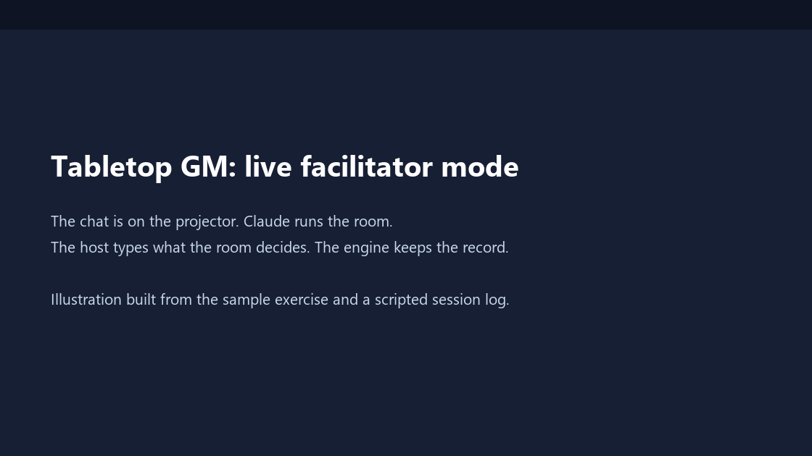
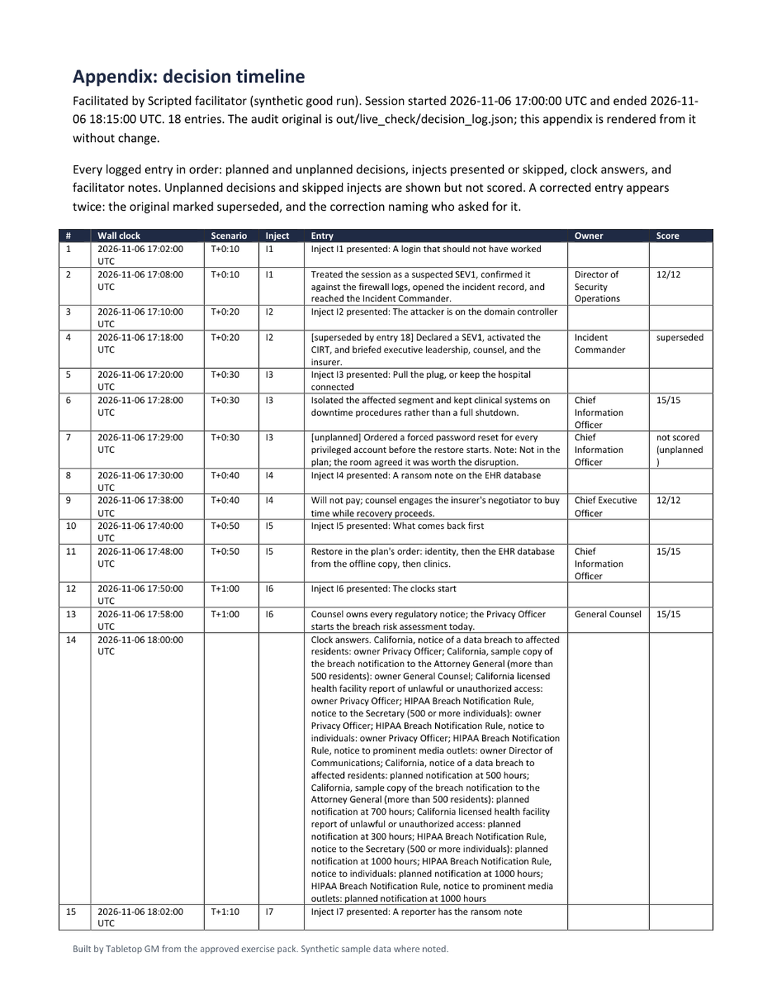
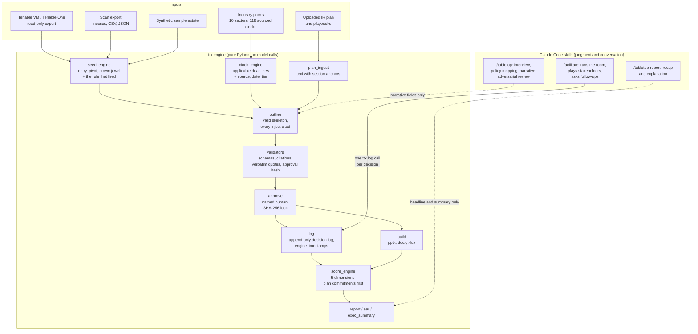

# Tabletop GM

**An AI facilitator that runs your incident response exercise, from your real exposure data, and scores it before the room empties.**

Tabletop GM runs an incident response exercise for your leadership team the way a good facilitator would. Put the chat on the projector. Claude presents each inject, reacts to what the room decides, plays the CEO, the regulator, and the press when the room stalls, and logs every decision as it happens. When the host types END, the room gets a scored after-action report and an executive summary in minutes, not weeks.

The scenario is not a template. It is built from your real exposure data (Tenable, a scan export, or a sample estate), your industry's real notification deadlines, and your own written incident response plan. A deterministic Python engine computes every fact that has to be right. Claude only does the judgment and the conversation.



*The exchange above is an illustration rendered from the sample exercise pack and a scripted session log in [`samples/live/`](samples/live/). The inject text, the roles, the logged decisions, and the score are real engine output; the chat frame is drawn, not screen-recorded.*

| | |
|---|---|
| **Try the facilitator** | Download the ZIP, double-click the launcher, choose 3. Claude runs the built-in sample exercise live in the chat. See [Quick start](#quick-start). |
| **Try the sample in 10 seconds** | Launcher option 1. No account, no keys, no network after setup. |
| **Sample outputs** | [Deck](samples/outputs/deck.pptx) · [Facilitator guide](samples/outputs/facilitator_guide.docx) · [Decision tracker](samples/outputs/decision_tracker_completed.xlsx) · [After-action report](samples/outputs/after_action_report.docx) · [Executive summary slides](samples/outputs/executive_summary.pptx) · [Executive memo](samples/outputs/executive_summary.docx) · [Live session logs](samples/live/) |
| **Engine files behind them** | [seed.json](samples/outputs/seed.json) (attack path) · [clocks.json](samples/outputs/clocks.json) (deadlines) · [exercise_pack.json](samples/outputs/exercise_pack.json) (approved outline) · [score.json](samples/outputs/score.json) |
| **Status** | 132 automated tests pass. Pure Python, six dependencies, MIT. Read-only against every external system. |

## Contents

- [The problem](#the-problem)
- [The facilitator agent](#the-facilitator-agent)
- [What it does](#what-it-does)
- [How the workflow goes](#how-the-workflow-goes)
- [Architecture](#architecture)
- [What it produces](#what-it-produces)
- [Why it is different](#why-it-is-different)
- [Prerequisites](#prerequisites)
- [How to run](#how-to-run)
- [Outputs](#outputs)
- [Industry packs](#industry-packs)
- [Known limitations](#known-limitations)
- [Roadmap](#roadmap)

## The problem

Regulators, insurers, and auditors expect organizations to exercise their incident response plan. Most tabletop exercises are still a generic ransomware story bought from a consultancy or copied from a template, read off slides by whoever drew the short straw. The scenario does not touch the systems the organization actually runs, the deadlines on the slides are whatever someone remembered, the "plan" the room is tested against is rarely the one in the binder, and nobody writes down who decided what, or when. The after-action report arrives weeks later and says "improve communication."

Tabletop GM fixes the four things that make an exercise worth running:

1. **A facilitator who runs the room.** Claude presents the scenario one inject at a time, applies pressure in character, asks the follow-ups a good facilitator asks, and never reveals what is coming.
2. **An attack path that is yours.** The entry point is an exploitable, internet-facing finding from your exposure data (CISA KEV first, then highest Tenable VPR). The pivot is your identity tier. The crown jewel is the asset that holds your regulated data. Every inject cites the finding it came from.
3. **Deadlines that are real and sourced.** An industry pack supplies every notification clock that applies to you, each with its source URL, the date it was checked, and whether a human has verified it.
4. **A record and a score, the same day.** Every decision is logged with its owner and a wall-clock timestamp. One command scores the session against your plan's own commitments and writes the after-action report and the executive summary.

## The facilitator agent

Live mode is a Claude Code skill, [`skills/facilitate/SKILL.md`](skills/facilitate/SKILL.md). The host opens a fresh chat, types `/tabletop`, chooses **Run an exercise live**, and puts the window on the projector. From there Claude is the game master and the engine is the scorekeeper.

**What Claude does in the room**

- **Presents each inject** in pack order, reworded to flow from what the room just decided, with the facts, names, and numbers unchanged.
- **Asks through the question UI**, so nothing is missed on a projector: the decision just posed, with **Pause**, **Skip this inject**, and **End the exercise** as one-click options and the room's actual answer typed in Other.
- **Plays the stakeholders.** When the room stalls, Claude speaks a short, labeled line as a role the pack defines, to force the decision the inject already poses: *CEO: "Do we pay or not? The board wants an answer by noon."*
- **Asks the follow-ups a facilitator asks**, at most two per inject and only from the pack's probing questions: who was notified, which steps were taken, how long the team says the action takes, whether it was written down.
- **Handles the off-script room.** A reasonable action the plan did not anticipate is logged as unplanned and the exercise steers back to the spine. "What if X?" gets "That's not known to you yet." A request for information the pack does not hold gets "You'd have to find that out. Who would you ask?" and the answer is logged.
- **Starts the clocks.** When the notification deadlines begin, Claude asks who owns each notice and when the team plans to send it, without revealing the deadline. The deadline is the recap's job.
- **Runs the hot wash and the recap.** After END, the room reviews the log, corrects anything misheard, and only then hears what good looked like, inject by inject, with every number from the score file.

**What Claude cannot do**

| Rule | Why it holds |
|---|---|
| Never add a fact | Every system name, finding, deadline, number, and plan quote comes from the approved pack or a `ttx` result. |
| Never reveal what is coming | No upcoming inject, expected action, or score until the recap. The prep chat holds the spoilers; the live run is a fresh session. |
| Never change the facts | "What if" does not move the scenario. The facilitator controls the clock. |
| Never reorder on its own | Injects run in pack order. Skip is the host's command. |
| Never state a time | Timestamps and discussion minutes come from `ttx log`, never from the model. |
| Never judge mid-exercise | Acknowledge, log, move on. The verdict is the score. |

**What the engine does underneath**

Every decision the host types becomes one `ttx log add` call: the inject, the decision in one sentence, the owning role, who was notified, which expected actions were covered, whether the plan step was followed, whether it was documented. The log is append-only. Corrections keep the original entry marked superseded. At END, `ttx report --log` exports the log in the tracker's shapes, scores it, and writes the after-action report with a decision timeline appendix, the executive slides, and the memo.



Two scripted sessions ship in [`samples/live/`](samples/live/): a team that follows its plan and one that does not. The tests export and score both.

## What it does

Tabletop GM ships as a Claude Code skill (`/tabletop`) on top of a deterministic command-line engine (`ttx`). The facilitator is the part the room sees. The rest builds the exercise it facilitates.

1. **Intake.** A few screens of clickable choices: industry, length (30, 60, or 90 minutes), severity 1 to 4, the data you hold, regulated status. Typing is limited to the organization's name and its US states.
2. **Policy ingest (optional).** `ttx ingest-plan` extracts your IR plan and playbooks with section anchors. Claude maps each procedure to an `org_plan.json` item carrying a verbatim quote, and the validator confirms every quote exists in the source.
3. **Attack path.** `ttx seed` picks the entry, pivot, and crown jewel from Tenable, an uploaded export, or the synthetic sample estate, and records the rule that fired for each. With no data, the scenario is generic and every assumption is labeled.
4. **Clocks.** `ttx clocks` returns the notification deadlines that apply, each with a source, a checked date, and a tier.
5. **Outline.** `ttx outline` writes a complete, valid skeleton. Each inject cites a finding or a labeled assumption and names the plan procedure it tests. Claude refines the narrative, then reviews it adversarially.
6. **Approval gate.** A named human approves the outline with `ttx approve`. Nothing runs or builds before that. Any later edit breaks the approval hash.
7. **Run it live.** Claude facilitates in the chat, as described above. The approved pack is the only input live mode needs.
8. **Or build the documents.** `ttx build` writes the deck, facilitator guide, participant handout, decision tracker, attendance sheet, and sign-off sheet from the approved pack, for a host who prefers a projector deck and a paper tracker.
9. **Score and report.** `ttx report` scores the live log or the filled tracker against your plan's own commitments and the pack defaults, then writes the after-action report and the executive summary in one step. For a pitch, `ttx report --demo` scores synthetic responses and marks every page as demo data.

## How the workflow goes

There are two people in the story: the **host** (the person who prepares and runs the exercise, usually a security lead) and the **room** (the executives and responders being exercised). The room never sees a terminal.

```mermaid
flowchart LR
    subgraph Prep["Before the day (host, in Claude Code)"]
        A["/tabletop interview<br/>a few clicks"] --> B["Drop IR plan and scan export<br/>in uploads/"]
        B --> C["Engine: seed, clocks, outline"]
        C --> D["Claude: narrative,<br/>adversarial review"]
        D --> E{"Host approves<br/>the outline"}
        E -- "change, easier, harder" --> D
    end
    subgraph Day["On the day (the room)"]
        E -- approve --> H["Fresh chat on the projector:<br/>Claude facilitates live"]
        H --> J["Room decides, host types,<br/>ttx log timestamps it"]
        J --> J2["Claude presses in character,<br/>asks follow-ups, starts the clocks"]
        E -- "approve, then ttx build" --> G["Alternative: deck on the projector,<br/>guide and tracker in hand"]
    end
    subgraph After["Afterwards (minutes)"]
        J2 -- END --> K["Log review and corrections"]
        G --> K2["/tabletop-report"]
        K --> L["ttx report --log:<br/>after-action report with timeline,<br/>executive slides and memo"]
        K2 --> L
        L --> M["Recap in the room:<br/>what good looked like,<br/>deadlines by the hour"]
    end
```



**Before the day, the host's afternoon:**

1. Open the folder in Claude Code and type `/tabletop`. Answer six short screens, mostly by clicking.
2. Optionally drop the IR plan, playbooks, or a scan export into `uploads/`. Claude offers to use them.
3. Review the outline as a table: each inject, the decision it forces, who owns it, and which plan procedure it tests. Click **Approve**, **Change an inject**, **Make it easier**, or **Make it harder**.

**On the day, the room's 90 minutes:** a fresh chat, `/tabletop`, **Run an exercise live**. Claude shows the ready card, then one inject at a time. The room talks; the host types the decision in one sentence. Claude logs it, presses when the room stalls, and asks who owns each notification when the clocks start. Pause, Skip, and End are always a click away.

**Afterwards, the host's ten minutes:** END. The room reads the log on the projector and corrects anything misheard. One command scores it and writes the reports. Claude gives the recap: the headline, the gaps with owners, the clocks met or missed by the hour, and only now what the expected good answers were.

**If you would rather run from a deck:** `ttx build` writes the slides, the facilitator guide, and a dropdown-only decision tracker. `/tabletop-report` scores the filled tracker the same way.

## Architecture

**Deterministic engine first, agent on top.** The engine computes every fact that has to be right. The agent is only allowed to converse and write prose on top of facts the engine returned, and validators check that it did.



The approved `exercise_pack.json` is the single source of truth. Live mode reads only that file. Every document reads only that file. Its hash is recorded in the decision log, on the sign-off sheet, and on the AAR evidence page.

| Guardrail | How it is enforced |
|---|---|
| No invented systems, findings, or deadlines | Claude writes narrative fields only, through `ttx narrate`. The seed, clocks, and citations come from the engine. The facilitate skill forbids naming anything the pack or a `ttx` command did not return. |
| Every inject cites its source | `ttx validate exercise-pack` fails any inject without a finding ID or a labeled assumption. |
| Every plan claim is a real quote | `ttx validate org-plan` rejects any quote not found verbatim in the extracted plan text. |
| Every clock is sourced and tiered | Pack schema requires `source_url`, `checked_date`, and `tier`. Researched-tier clocks carry a "verify before exercise" banner on every output. |
| Human in the loop | `ttx approve --by <name>` locks the pack. `ttx log start` and `ttx build` refuse an unapproved or modified pack. Claude never approves on anyone's behalf. |
| The engine owns time | `ttx log` stamps every entry with the wall clock and computes discussion minutes. The agent never states a time. |
| The log is the audit original | Append-only. `ttx log edit` keeps the original entry marked superseded and records who asked for the correction. `ttx log add` refuses an inject, role, or action id that is not in the pack. |
| Read-only everywhere | Tenable export endpoints only. One optional unauthenticated GET for the CISA KEV feed. No telemetry. Live mode adds no outbound calls. [SECURITY.md](SECURITY.md) lists every call. |
| No secrets or real data in the repo | `.env`, `uploads/`, and `out/` are gitignored. Samples are synthetic. |
| Reproducible without a model | Every document rebuilds from `exercise_pack.json` with no API key. 132 tests cover the engine, validators, builders, scoring, launcher, and the live log. |

The code is about 7,400 lines of Python across `ttx/` and `ttx/build/`, plus the skills under `skills/` and `.claude/skills/`, the schemas under `schemas/`, and the industry packs under `skills/industry_packs/`. [docs/BUILD_SPEC.md](docs/BUILD_SPEC.md) is the full specification, [docs/LIVE_GM_ADDENDUM.md](docs/LIVE_GM_ADDENDUM.md) specifies live mode, and [docs/DECISIONS.md](docs/DECISIONS.md) records the build decisions.

## What it produces

The same engine that keeps the live record also builds a full document set, for a host who wants a projector deck, and for the auditors, the board, and the security team afterwards.


*Every frame above is a real page from the committed sample run in [`samples/outputs/`](samples/outputs/), rendered with Microsoft Office.*

**The after-action report** opens with the result, lessons learned, and one row per decision. Scores by dimension, the plan coverage map, every gap with its citation, and an evidence page with hashes sit in the appendix. After a live session, so does the decision timeline.


**The executive summary** is seven slides and a one-page memo: a plain-language bottom line, a readiness rating, regulatory exposure, lessons learned, the fixes with owners and due dates, and the decisions leadership needs to make. No finding IDs, no rubric.


**The deck and the facilitator guide**, for a room that runs from slides: one slide per inject with the host lines in the speaker notes, and a guide with the decision, its owner, the verbatim plan quote, what good looks like, where teams fail, and the probing questions.


**The decision tracker**, for the same room: one color-coded block per inject, dropdowns and Yes/No only, with the plan's own commitment beside each answer.


## Why it is different

- **It facilitates. It does not just generate.** The room talks to a game master that presents, presses, follows up, and keeps the record, and that cannot be talked into inventing a fact or revealing the next move.
- **Exposure data becomes something the board sees.** The scenario walks the attack path your scanner already found. The executive summary ends with "fix the open weakness on vpngw01 (CVE-2025-0282), owner, due date." That is the shortest path from a vulnerability finding to a funded decision.
- **The exercise tests the plan you actually wrote.** Each inject quotes the section it tests. The score measures the room against the plan's own timing commitments first, and against industry defaults only where the plan is silent. "The plan is silent on ransom payment" is a finding, with a fix and an owner.
- **The deadlines are auditable.** Every clock has a source, a checked date, and a verification tier. The AAR says which notices were planned on time, which were late and by how much, and which had no owner.
- **The record is defensible.** Append-only log, engine timestamps, corrections that keep the original, a hash of the approved pack on every output. An auditor can read the timeline appendix and see who decided what, and when.
- **It is honest about what it knows.** Assumptions are labeled. Researched clocks are flagged. Unplanned decisions are shown but never scored.
- **It runs anywhere and is safe to point at production.** Pure Python, six dependencies, no Docker, no database. Read-only Tenable keys are enough. Nothing is written to any external system, ever.

## Prerequisites

- **To see the sample exercise:** nothing. The launcher sets everything up.
- **Python 3.11 or newer.** The Windows launcher offers to install it for you. On macOS it offers Homebrew if you have it, or opens the download page.
- **Internet on the first run only,** to download the document libraries. After that, everything except the guided workflow runs offline.
- **To run the facilitator, or build an exercise for your own organization:** Claude Code (terminal, desktop app, or IDE) and a Claude account. The launcher tells you how to install it if it is missing.
- **Optional:** read-only Tenable Vulnerability Management or Tenable One API keys, for live exposure data.

There is no git, Docker, Node, database, or cloud service to set up. The dependencies are pure Python: python-pptx, python-docx, openpyxl, pyyaml, pypdf, and jinja2.

## How to run

### Quick start

1. **Download.** On this GitHub page, click **Code**, then **Download ZIP**, and unzip it anywhere. Or clone it with git.
2. **Double-click the launcher for your computer:**
   - Windows: `start-windows.bat`
   - macOS: `start-mac.command`. The first time, macOS may warn about an unidentified developer: right-click the file, choose **Open**, then **Open** again.
   - Linux: run `./start-linux.sh` in a terminal.
3. **Pick from the menu:**
   - **1. See a finished sample exercise.** About 10 seconds, no account. It builds the complete Valley Regional exercise and opens the folder. Start with `START_HERE.txt`.
   - **2. Build an exercise for my organization.** This opens Claude Code in the folder and starts the `/tabletop` interview.
   - **3. Run an exercise live in chat.** Claude facilitates in the chat. With nothing built yet, it runs the sample exercise. See [Run it live in chat](#run-it-live-in-chat).

The first run takes a minute or two. The launcher creates a private `.venv` folder inside the download and installs into it, so nothing else on your computer changes. Later runs go straight to the menu.

### Run it live in chat

1. Open a new chat in the folder, type `/tabletop`, and choose **Run an exercise live**. Use a new chat, not the one where you built the exercise, because that one holds the answers.
2. Pick your exercise, or the built-in sample if you just want to try it.
3. Put the chat on the projector. Claude shows the ready card and asks whether the room is ready. From there it presents one inject at a time, and every question comes with **Pause**, **Skip this inject**, and **End the exercise** as clickable options. The room's decision goes in Other.
4. Click **End the exercise**, or type `END`, when you are done. Claude shows the log for corrections, writes the scored after-action report and executive summary into `out/live/`, runs the hot wash, and gives the recap.

The sample exercise is already approved, so option 3 in the launcher is the quickest way to see the facilitator work.

### Build an exercise for your organization

`/tabletop` opens with four choices: build a new exercise, run one live in chat, score one you have run, or see the sample.

**Building takes a few minutes, mostly clicks:**

1. Type the organization's name.
2. Click through industry, length (30, 60, or 90 minutes), severity, and whether it is publicly traded.
3. Type the US states it operates in.
4. Tick the data it holds and the regulated statuses that apply.
5. Pick the exposure data source.
6. Review a summary screen with sensible defaults for everything else.

You can drop your IR plan, playbooks, or scan exports into the `uploads/` folder, and Claude offers to use them.

Claude then shows the outline as a table: each inject, the decision it forces, who owns it, and which of your procedures it tests. Click **Approve**, **Change an inject**, **Make it easier**, or **Make it harder**. Nothing runs or builds until you approve. Then open a fresh chat to run it live, or let `ttx build` write the documents into `out/build/`.

**After a deck-and-tracker exercise:**

1. Save the filled tracker into the `uploads` folder, or drag it into the chat.
2. Type `/tabletop-report`.

It scores the tracker and writes the after-action report and the executive summary into `out/report/`.

**For a pitch or a practice run:** type `/tabletop-report` and choose demo responses, or run `ttx report --demo --open`. It scores the invented answers in `samples/demo_responses/` against your approved exercise (or the built-in sample) and writes the same reports into `out/report_demo/`, marked as demo data on every page.

The project pre-approves only Tabletop GM's own commands (`.claude/settings.json`), so Claude Code does not ask permission at every step. Claude Code shows these rules in its trust prompt the first time you open the folder.

If you already use Claude Code, you can skip the launcher. Open the downloaded folder in Claude Code and type `/tabletop`; it installs what it needs on its own.

### Command line

Everything the launcher and Claude do is a plain `ttx` command, and every document can be rebuilt with no model call.

```bash
git clone https://github.com/eshin087/tabletop-gm.git
cd tabletop-gm
python -m venv .venv
```

Activate the environment (`source .venv/bin/activate` on macOS and Linux, `.venv\Scripts\Activate.ps1` on Windows), then:

```bash
pip install -e ".[dev]"
pytest -q
ttx demo --no-open
```

The full pipeline, step by step, on the committed sample:

```bash
ttx packs
ttx ingest-plan samples/sample_ir_plan.md --out out/plan_text.json
ttx validate org-plan samples/org_plan_sample.json --plan-text out/plan_text.json
ttx seed --intake samples/intake_valley_regional.yaml --out out/seed.json
ttx clocks --intake samples/intake_valley_regional.yaml --out out/clocks.json
ttx outline --intake samples/intake_valley_regional.yaml --seed out/seed.json --clocks out/clocks.json --org-plan samples/org_plan_sample.json --out out/exercise_pack_draft.json
ttx narrate out/exercise_pack_draft.json samples/narrative_overlay_sample.json
ttx validate exercise-pack out/exercise_pack_draft.json
ttx approve out/exercise_pack_draft.json --by "Your Name" --out out/exercise_pack.json
ttx build out/exercise_pack.json --out out/build
ttx report --pack out/exercise_pack.json --tracker samples/outputs/decision_tracker_completed.xlsx --out out/report
```

The live decision log, which is what the facilitator drives one call at a time:

```bash
ttx log start --pack out/exercise_pack.json --out out/live --by "Facilitator name"
ttx log mark --inject I1 --event presented
ttx log add --inject I1 --decision "Treated it as a suspected SEV1 and called the Incident Commander" --by security_operations --actions I1-P16,I1-d1 --plan-step yes --documented yes --scenario-minutes 10
ttx log show
ttx report --log out/live/decision_log.json
```

See [docs/CLI.md](docs/CLI.md) for every command, the export and live Tenable modes (`ttx seed --mode export` and `--mode tenable`), and every `ttx log` subcommand.

## Outputs

`ttx report --log` (live mode) and `ttx report` (tracker mode) write the scored record set. `ttx build` writes the room documents from the approved `exercise_pack.json` only.

| File | For | Contents |
|---|---|---|
| `out/live/decision_log.json`, `decisions.csv`, `decisions_clocks.csv` (from `ttx log`) | Live mode | The append-only decision log of a chat-facilitated session (the audit original) and its export in the tracker's column shapes, which `ttx score` reads unchanged. |
| `after_action_report.docx` (from `ttx report`) | Security team, auditors | About two pages: headline and readiness rating, lessons learned (what worked, what to improve), one row per decision, each notification deadline met or missed, and an action plan with owners and due dates. The appendix holds the scores by dimension, the plan coverage map, every gap with its citation, and an evidence page with hashes. After a live run, a decision timeline appendix. |
| `executive_summary.pptx`, `executive_summary.docx` (from `ttx report`) | Senior management | Seven slides and a one-page memo: a plain-language bottom line, an overall readiness rating (Strong, Adequate, Needs work), regulatory exposure, the top three risks, lessons learned, the top five fixes with owners and dates, and the decisions needed from leadership. No finding IDs or rubric detail. |
| `deck.pptx` | The room, deck mode | Title, ground rules, objectives, roles, setup, one slide per inject, hot wash, next steps. Inject slides are numbered to match the guide. Host lines are in the speaker notes. No spoilers. |
| `facilitator_guide.docx` | Facilitator, deck mode | Timing table, then per inject: host lines, the decision and its owner, a "what the plan says" box with the verbatim quote, good answers, where teams fail, expected-action checklists, hints, probing questions, and the source finding. Ends with every clock and its source. |
| `participant_handout.docx` | Everyone | Roles, ground rules, a contact-list template, and note space. No inject content. |
| `decision_tracker.xlsx` | Host, deck mode | One color-coded block per inject with plain questions and dropdowns: who made the call, how fast, Yes/No for each expected action and notification, plan followed, written down. Only the two optional note rows are typed. A Notification clocks sheet records who owns each notice and when they will send it. `ttx report` reads it. |
| `attendance_signin.xlsx`, `signoff_sheet.docx` | Audit evidence | Sign-in and roles-present sheets. The sign-off covers scope, approval record, documents exercised, requirements supported, clocks, and an attestation. |

Option 1 in the launcher (or `ttx demo`) rebuilds the same sample into `out/demo/` with a `START_HERE.txt` guide. [`samples/outputs/`](samples/outputs/) holds one complete synthetic run: the documents above plus `seed.json`, `clocks.json`, `exercise_pack.json`, a synthetic completed tracker, and `score.json`. The sample rates Adequate at 82.8% across 7 decisions, with 4 of 6 notification deadlines met. Its regulatory clock line is the HIPAA media notice, planned 30 days late. The California health department report had no owner. The sample report lists 2 plan gaps, 11 people gaps, and 3 technical gaps. [`samples/live/`](samples/live/) holds two scripted live-session logs, one that follows the plan and one that does not.

## Industry packs

`ttx packs` lists what ships. Each pack holds the sector's notification clocks, exercise requirements, default expected actions, roles, and notify parties.

| Pack | Clocks | Exercise requirements |
|---|---|---|
| healthcare | 7 | 2 |
| banking (banks and credit unions) | 8 | 2 |
| insurance (incl. NYDFS Part 500) | 4 | 2 |
| public_sector (state, local, tribal, K-12) | 8 | 1 |
| higher_education | 3 | 2 |
| saas_technology | 10 | 1 |
| retail_ecommerce | 2 | 1 |
| manufacturing_ot | 5 | 3 |
| energy_utilities | 9 | 3 |
| federal_contractors | 6 | 2 |
| `clocks_common.yaml` (GDPR, UK GDPR, SEC 8-K, CIRCIA, Visa, state breach laws) | 56 | n/a |

Every clock is at the researched tier: drafted from a primary source with a citation, not yet human-verified. See Known limitations. The `pack_research` skill drafts a pack for any other industry from `skills/industry_packs/_template/`.

## Known limitations

- **No clock is human-verified yet.** All 118 clocks were drafted by Claude from primary sources on 2026-11-03, but no human has checked them. Every output that uses them carries a "verify before exercise" banner, and the AAR evidence page lists them as unverified. A few clocks whose source could not be fetched say so in their notes. To promote a clock, set `tier: verified`, `verifier`, and `verified_date` after opening its source.
- **Live mode relies on the host typing.** When Claude facilitates in chat, the record is only as complete as what the host types in; voice capture of the room is roadmap. Timestamps and discussion minutes are measured from when each decision is typed.
- **Live mode is tested through scripted logs, not a live model.** The two sessions in `samples/live/` were produced by the engine's own API with fixed timestamps, and the tests export and score them. The facilitator's conduct is specified in the skill and exercised by hand, not by automated tests, because tests cannot call a model.
- **Deadline arithmetic is simplified.**
  - Business-day deadlines skip weekends but not public holidays.
  - Calendar-month deadlines are stored as 720 hours.
  - "Concurrent with" and "prior to" agency notices are modeled with the parent deadline. Only explicit "within N days after notice" clocks are chained.
- **Some thresholds are approximate.** Per-state resident thresholds use the intake's total affected estimate. Clock applicability depends on the intake's regulated flags being right.
- **Live Tenable mode is untested in CI.** It uses read-only export endpoints and the field names recorded in the build spec. Automated tests cannot reach the network, so live mode is not exercised there.
- **Attack paths are inferred.** Tenable One attack path ingestion is not wired to the API, so live runs report `path_source: inferred` unless the estate file carries `attack_paths`.
- **Crown-jewel matching is heuristic.** When assets carry no data tags, it falls back to hostname and software patterns, and the seed records which rule fired.
- **Some inputs are not supported.** Scanned PDFs (OCR) are not supported. The .nessus parser reads only the basic fields.
- **The CLI never calls a model.** `ttx outline` writes template prose that is valid and buildable but generic. The tailored narrative comes from Claude in the `/tabletop` workflow.
- **Scoring is only as good as the record.** It is deterministic given the log or the tracker, but timeliness uses the minutes the engine measured or the host recorded.
- **Samples are synthetic.** Valley Regional, its estate, its IR plan, its completed tracker, and its live logs are invented. CVE identifiers are real public identifiers, used so the KEV logic means something. IP addresses use documentation ranges.
- **Pre-approved commands depend on Claude Code's trust prompt.** Claude Code applies the project's allow rules only after you accept the trust prompt for the folder. The Windows rule's backslash path has not been confirmed in a live session; if Claude Code still asks, choose "don't ask again" once.
- **Executive ratings use fixed thresholds.** Strong is 85% and up, Adequate is 70 to 84%, and Needs work is below 70%. Tune them to your organization's appetite in `ttx/build/exec_summary.py`.
- **Launchers were tested on Windows only.** The Windows launcher was run from a fresh copy. The macOS and Linux launchers are plain shell scripts but have not been run on a Mac or a Linux desktop yet. macOS Gatekeeper asks for a right-click Open the first time.
- **No second-screen host console ships.** The browser host console (`host.html`) and `ttx host` are not shipped. Run the exercise live in chat, or from the facilitator guide and the tracker; see Roadmap.
- **The images in this README** were rendered from the committed sample with Microsoft Office, and the chat sequence is a drawn illustration of the sample pack and a scripted log, not a screen recording. The files in `samples/` are the source.

## Roadmap

- Voice capture of the room, so the host stops typing.
- `host.html`: a self-contained host console for a second laptop, with click-based decision capture, a timer, and tracker export.
- `ttx host`: a standard-library local server with an AI co-host that follows `skills/host_copilot/SKILL.md`.
- Human verification of the healthcare and banking clocks first, then the rest.
- More packs through `pack_research`, plus community contributions.
- Tenable One attack path API ingestion and a Qualys/Rapid7 column map.
- Slack and Teams rooms, an adaptive attacker, and quarterly reruns on unfixed paths.
- An MCP wrapper over the `ttx` commands.

See [SECURITY.md](SECURITY.md) for every outbound call and [docs/DECISIONS.md](docs/DECISIONS.md) for build decisions. MIT licensed. Built by gcd with Claude Code.
